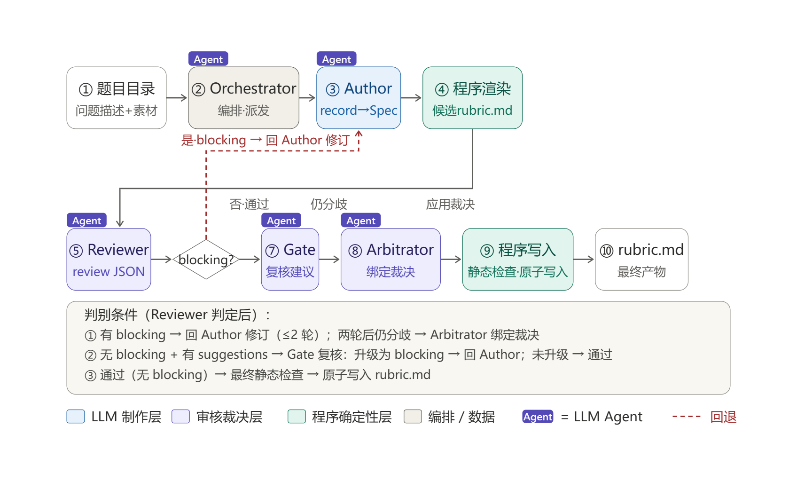

# Rubric-Council

面向 AI Agent 测评的逐题评分标准生成器。输入每道题的**问题描述和源素材**，由 OpenCode 驱动制作、独立审核、建议分类、修订与裁决，最终生成针对每道测试题目的定制化 `rubric.md`。

本项目负责制作评分标准，不读取受测对象的交付文件，也不执行评分或生成测评报告。生成并确认一套 Rubric 后，可以固定复用。

## Pipeline



流程图展示主要制作与审核环节；数据集调度、检查点和自动恢复由 Python 程序负责。

1. **审题与核验**：制作角色读取题目、提取素材、核验事实或复算数据，形成内部制作记录。
2. **制定评分规则**：生成结构化 Rubric 规格，明确评分原子、权重、状态函数、证据位置及允许的答案差异。
3. **独立审核与修订**：审核题意、来源、可计算性及扣分边界；通过但仍带建议的审核结果，会进一步做建议严重性分类。默认最多一轮定向修改，仍有阻断分歧时进入裁决及最终补丁修订、复核。
4. **校验与保存**：程序检查结构、记录与规格的一致性，再确定性渲染 Markdown；通过后将 `rubric.md` 写入题目目录。
5. **自动恢复**：保存有效阶段检查点，失败后在有限次数内继续未完成题目，避免整个数据集从头重跑。

具体评分项由题目及源素材决定；审核不能凭个人偏好新增交付要求。来源、评分公式、职责边界和允许的合理答案差异必须在最终 Rubric 中说清楚。

## 数据集格式

程序递归查找名称为 **`问题描述.txt`** 的文件，以该文件所在目录作为一道题。

```text
测试数据集/
├── 维度1_信息检索/
│   ├── W1_多源信息交叉验证/
│   │   └── 问题描述.txt
│   └── W2_研究报告/
│       ├── 问题描述.txt
│       ├── 参考资料.pdf
│       └── 数据.xlsx
└── 维度2_办公任务/
    └── O1_多文件汇总/
        ├── 问题描述.txt
        ├── 文档.docx
        └── 演示.pptx
```

- **必需输入**：每道题一份 UTF-8 编码的 `问题描述.txt`，写明任务、交付要求和必要的时间或版本约束。
- **可选输入**：该题需要的原始素材，可直接放在题目目录，也可放在其子目录中。
- **目录命名**：维度和题目名称可自行设置；维度层不是必需层。题目目录之间应并列，避免在一道题目录中嵌套另一道题。
- **输入边界**：题目目录只放问题和源素材，不混入受测交付、历史评分或评测报告。程序会排除已识别的 Rubric 文件，但不会自动识别并排除任意交付文件。
- **重新生成**：为保留历史版本，先复制问题与素材到不含旧 `rubric.md` 的新数据集目录，再启动新运行。

内置素材提取支持文本、CSV/TSV、JSON、HTML等文件，以及 PDF、DOCX、PPTX、XLSX。PDF主要提取可读文本，Word/PPT主要提取文字和表格，Excel保留单元格位置、值、公式及缓存值。扫描件、图片、图表或复杂版式不能仅靠文字提取完整理解，应另行提供可核验的文字/数据材料或视觉处理支持。

最终输出保存在各题目录中，例如：

```text
W2_研究报告/
├── 问题描述.txt
├── 参考资料.pdf
├── 数据.xlsx
└── rubric.md              # 成功后由程序生成
```

## 安装

需要 Python **3.11+**、[uv](https://docs.astral.sh/uv/)、Git、OpenCode CLI，以及支持工具调用和工具结果续写的模型服务。

克隆当前提供自主运行入口的分支：

```bash
git clone --branch release/2026-10-12-evidence-contract-v1 https://github.com/Ma-Ruinan/Rubric-Council.git
cd Rubric-Council
uv sync
```

`uv sync` 会一次安装项目所需的文档处理和统计复算依赖。

## API 与模型配置

项目通过 OpenCode 访问模型，可替换为其他支持工具调用的 **OpenAI 兼容 API** 来源。首次使用，按当前兼容模式示例复制配置文件：

```bash
cp opencode.v1.example.jsonc opencode.jsonc
```

只需关注以下三个位置：

| 要替换的内容 | 修改位置 | 填写什么 |
|---|---|---|
| API 地址（URL） | `opencode.jsonc` 中的 `baseURL` | 服务商提供的当前有效 Base URL，例如 `https://your-api.example/v1` |
| API 密钥（SK） | 项目根目录 `.env` 中的 `API_KEY` | 自己的密钥，例如 `sk-your-api-key` |
| 模型名称 | `opencode.jsonc` 中的模型定义/默认 `model`，以及 `rubric-generator.toml` 中各角色的 `model` | 服务商实际支持的模型 ID；只换 URL/密钥且模型未变时无需改动 |

在项目根目录创建 `.env`：

```dotenv
API_KEY=sk-your-api-key
OPENCODE_RUN_MODE=legacy
```

上述 URL 和 API Key 是占位示例，须替换为真实值。`custom` 是通用的本地提供商标识，不代表具体服务商。模型引用格式为 `提供商标识/模型 ID`，例如 `custom/z.ai/glm5-3`。

默认模型引用为 `custom/deepseek-v4.1-flash#high`。换模型时同步更新两个配置文件中的引用；不支持 `high` 变体的模型应去掉相应后缀及变体配置。

`opencode.jsonc` 和 `.env` 已被 Git 忽略。终端中已有的同名环境变量会优先于 `.env`。其他 CLI 模式、可执行文件路径和详细字段位置见 [OpenCode CLI 配置说明](docs/opencode-cli-compatibility.md)。程序开始前会做一次小型工具续写检查，通过后再处理题目。

## 推荐用法：自主生成整个数据集

```bash
uv run rubric-generator run \
  --dataset "D:/path/to/测试数据集" \
  --run-id "benchmark-20261014-t0" \
  --temperature 0 \
  --execution-contract \
  --concurrency 3 \
  --timeout 1800
```

该命令会处理数据集中的全部题目，实时显示阶段日志，保存检查点，并在失败后自动续跑未完成题目。

| 参数 | 含义 | 默认值或约束 |
|---|---|---|
| `--dataset` | 数据集根目录 | 必填；包含各题的 `问题描述.txt` |
| `--run-id` | 本次运行的唯一编号，用于定位日志和恢复 | 必填；字母或数字开头，其后可用字母、数字、点、下划线、连字符；最长121字符 |
| `--temperature` | 覆盖本次 OpenCode 角色的回复温度 | 可设0；不传则沿用角色配置，目前角色默认0.1 |
| `--execution-contract` | 校验并输出取证政策、缺陷主责、封顶要件与排除项 | 可选；建议新的评测标准启用 |
| `--concurrency` | 同时处理的题目数 | 默认3，可选1、2、3；不是每分钟请求数 |
| `--timeout` | 每次 OpenCode 角色调用的超时秒数 | `run` 默认1800；不是整题或整个数据集的总时限 |
| `--max-attempts` | 父调度器最多执行的数据集尝试轮数，包含首轮 | 默认8 |
| `--max-stalled-attempts` | 连续没有完成数或有效检查点进展的轮数上限 | 默认3 |
| `--retry-delay` | 失败轮次后等待的初始秒数 | 默认30；连续停滞时递增，等待最多300秒 |

**首次 `run` 要求题目目录没有 `rubric.md`**，避免覆盖旧规则。若已有结果，请使用不含旧 Rubric 的数据集副本。温度0用于减少模型输出随机性，不保证不同运行结果完全相同。

### 继续同一次运行

若终端退出或程序停止，保留原输入和配置，重新执行上面**相同的 `run` 命令**。程序会核对运行绑定、跳过已完成题目并复用有效检查点，继续未完成部分。

- 输入、模型、温度或 `--execution-contract` 设置变化时，使用新的 `run-id`；制作另一套规则时也应使用新的数据集副本。
- 达到尝试或无进展上限、发现不可恢复的输入/权限/认证问题时，程序保留记录并停止，不会将失败伪装为成功。
- 同一运行不能同时启动两个调度器。父进程异常退出而子进程仍运行时，应先等待子进程结束再恢复。
- 已结束轮次的重试预算会保留；父进程在轮内被强制终止时，该轮计数仍可能漏记，不能视为已覆盖所有崩溃情形。

## 其他终端命令

这些入口用于单轮生成、人工指定续跑、静态审计或隔离回归；整个数据集的自动恢复推荐使用上面的 `run`。

### 只生成部分题目

#### 单独运行某一道题

将 `--dataset` 直接指向该题目录，例如只运行 W1：

```bash
uv run rubric-generator run \
  --dataset "D:/path/to/测试数据集/维度1_信息检索/W1_多源信息交叉验证" \
  --run-id "single-w1-20261014-t0" \
  --temperature 0 \
  --execution-contract \
  --concurrency 1 \
  --timeout 1800
```

此时程序只查找该题目录中的 `问题描述.txt`，保留 `run` 的自动恢复能力。首次运行仍要求该目录没有 `rubric.md`。不要把包含其他题目的上层目录误当作单题目录。

#### 运行某个维度的前几道题

下面生成“维度1_信息检索”中的前两道题：

```bash
uv run rubric-generator generate \
  --dataset "D:/path/to/测试数据集" \
  --run-id "pilot-20261014-t0" \
  --task-pattern "维度1_信息检索" \
  --limit 2 \
  --temperature 0 \
  --execution-contract \
  --concurrency 2 \
  --timeout 1800
```

`--task-pattern` 按题目相对目录做不区分大小写的子串筛选；`--limit 2` 取筛选结果的前两道题。顺序来自程序对问题文件路径的排序，不是按题号数值排序。已有 `rubric.md` 的题目默认跳过，不会自动补选其他题目。

#### 精确指定几道题

先只读列出题目编号和对应目录；这条命令不会调用模型：

```bash
uv run python -c "from pathlib import Path; from rubric_generator.dataset import discover_tasks; [print(t.task_id, t.relative_dir) for t in discover_tasks(Path('D:/path/to/测试数据集'))]"
```

从输出中复制需要的 task ID，重复传入 `--task-id`，例如指定两道题：

```bash
uv run rubric-generator generate \
  --dataset "D:/path/to/测试数据集" \
  --run-id "selected-20261014-t0" \
  --task-id "W1_多源信息交叉验证-替换为实际编号" \
  --task-id "O1_多文件汇总-替换为实际编号" \
  --temperature 0 \
  --execution-contract \
  --concurrency 2 \
  --timeout 1800
```

两个 `--task-id` 都必须替换为上一步列出的完整编号；不是直接填题目名称。可以重复传入更多编号，也可以只传一个编号指定单题。

`generate` 是单轮入口，不带 `run` 的跨轮自动恢复；失败后用同一 `run-id` 的 `resume` 续跑，并保留相同筛选范围。加 `--force` 才会重做并备份已有规则。

### 指定失败题续跑

```bash
uv run rubric-generator resume \
  --dataset "D:/path/to/测试数据集" \
  --run-id "pilot-20261014-t0" \
  --task-pattern "维度1" \
  --missing-only \
  --temperature 0 \
  --execution-contract \
  --concurrency 2 \
  --timeout 1800
```

`resume` 复用同一运行的有效检查点；`--missing-only` 只选择尚无 `rubric.md` 的题目。若不加它，`resume` 也可选择已有规则的题目，完成后可能替换并备份规则，需注意筛选范围。需要重新审核时可加 `--refresh-reviews`，归档旧审核及下游修订，保留有效初始制作检查点后重审。

`generate` / `resume` 还支持重复传入 `--task-id` 精确筛选题目；自动生成的 task ID 可从运行目录的 `tasks/` 或任务状态文件中查到。两者的默认超时是900秒，示例显式设为1800秒。

### 只读审计已有 Rubric

```bash
uv run rubric-generator audit --dataset "D:/path/to/测试数据集"
```

只做静态检查，不调用模型、不修改文件。`USABLE` 表示未发现阻断性的静态问题，`BLOCKING` 表示存在结构问题，`ADVISORY` 是非阻断提示；静态通过不代表事实和评分语义已经完全验证。

### 隔离回归

```bash
uv run rubric-generator regression \
  --source "D:/path/to/参考数据集" \
  --limit 1 \
  --concurrency 1
```

复制题目和素材到独立工作区，重新生成并比较，不修改参考数据集；该命令会调用模型。

### 查看命令帮助

```bash
uv run rubric-generator --help
uv run rubric-generator run --help
```

也可使用 `uv run python -m rubric_generator.cli run ...`。全局参数 `--project-dir` 必须写在子命令之前，用于显式指定配置和运行目录所在的项目根目录。

## 输出与下游接口

每道题的 `rubric.md` 定义以下评分接口，具体分数由下游评测器按交付证据计算：

| 评分项 | 量程 |
|---|---|
| 任务完成率 | 0.00%—100.00% |
| 内容覆盖度 | 0.00—5.00 |
| 准确率·忠实度 | 0.00—5.00 |
| 格式合规度 | 0.00—5.00 |
| 结构完整度 | 0.00—5.00 |
| 幻觉／自洽性 | 0.00—5.00 |

名称与量程固定，但每题的原子、权重、锚点及 `BIN` / `RATIO` / `COUNT` / `CLAIM-RATIO` 状态规则按题目制定。项目不输出单一0—100综合总分；任务完成率与质量指标分别定义。

| 位置 | 内容 |
|---|---|
| 数据集各题目录的 `rubric.md` | 最终可用于评测的评分标准 |
| `.rubric-generator/runs/<run-id>/tasks/` | 各题输入快照、素材提取、制作记录、规格、审核、补丁、模型事件和状态 |
| `.rubric-generator/runs/<run-id>/supervisor/` | 自主调度状态、每轮记录、完成清单和 `native.log` |
| `.rubric-generator/call-diagnostics/` | 调用超时或长度上限等诊断事件 |
| `regression/runs/` | 隔离回归副本及比较结果 |

中间制作记录、规格和审核文件用于追溯，不是下游评测的必需输入。最终 Rubric 应自包含，仅引用题目目录中的真实素材或题目允许的外部来源，不依赖项目内部路径。

## 离线测试

运行离线测试：

```bash
uv run python -m unittest discover -s tests -v
```

测试使用模拟模型响应，不调用远端模型。运行日志、私有配置、密钥及本地测试数据集不随仓库发布。

## 配置说明与许可证

- [OpenCode CLI 兼容配置与常见问题](docs/opencode-cli-compatibility.md)
- [`opencode.v1.example.jsonc`](opencode.v1.example.jsonc)：兼容模式模板。
- [`opencode.example.jsonc`](opencode.example.jsonc)：standalone 模式模板。
- [`rubric-generator.toml`](rubric-generator.toml)：按角色选择模型。
- [MIT License](LICENSE)
